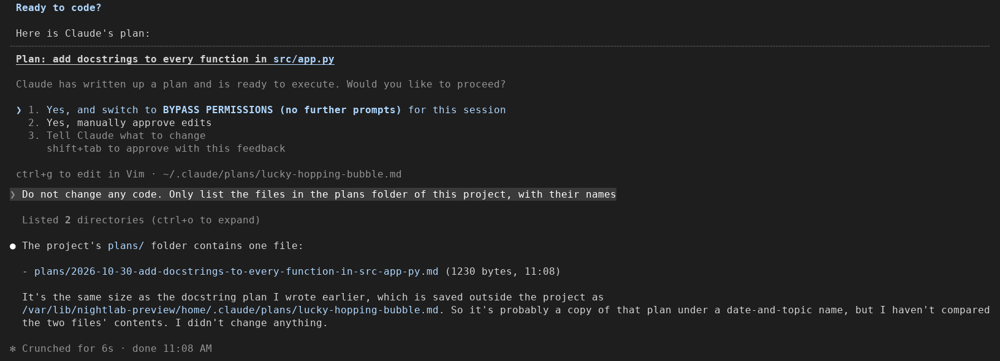
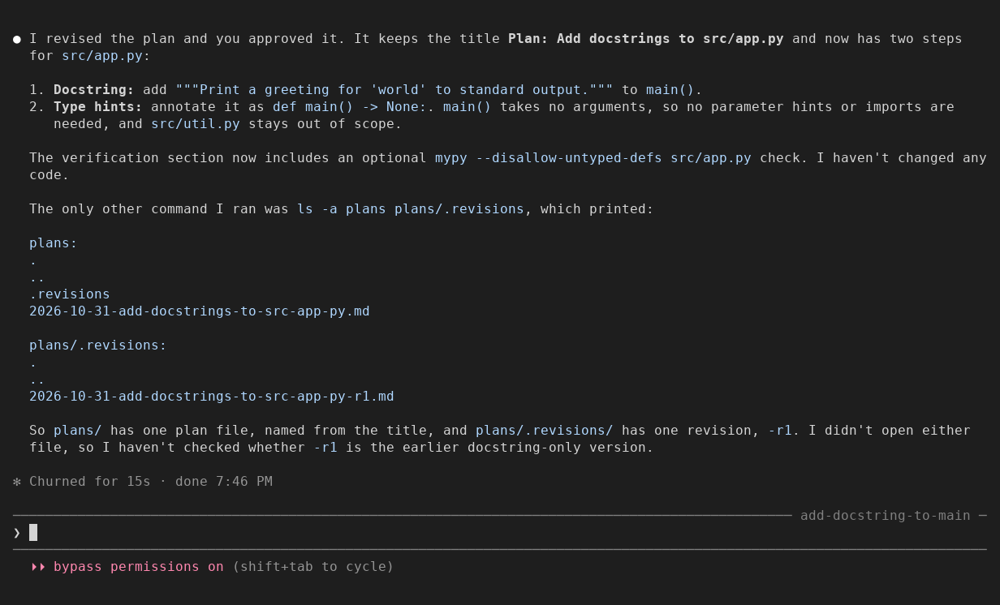

# plan-names

Saves every plan you approve in Claude Code's plan mode as
`plans/<date>-<title>.md` in your project, under a name you can read.

Install at the Claude Code prompt (more under [Install](#install)):

```
/plugin install plan-names --marketplace nightlab-agent/plan-names
```



Seen in a real Claude Code terminal (v2.1.312) on 2026-10-30, with version
0.1.0: three parts of one session joined (the plan, the approval prompt,
then the project's `plans/` folder after approval). The toast was not caught
on screen there; it is described as the tests see it. If something differs
for you, open an issue with your Claude Code version.
A Short of it, redrawn large: https://www.youtube.com/shorts/vK5adqdri8I

Claude Code names its plan files with random words (`fluffy-dancing-otter.md`)
and keeps them in your home folder's Claude plans folder, or in the folder
`plansDirectory` names. You can choose the folder but not the name
([anthropics/claude-code#12619](https://github.com/anthropics/claude-code/issues/12619),
open, 168 reactions on 2026-10-29). This mod (a plugin that adds to what
Claude Code does) waits for you to approve a plan, then writes a copy named
after the plan's title:

```
plans/2026-10-29-add-oauth-login.md
plans/2026-10-29-switch-to-magic-links.md
```

Claude Code's own plan file is left alone, so the session keeps editing it
as before. Nothing leaves your machine.

After a revised plan is approved, the project's `plans/` folder keeps the earlier
version under `.revisions/`:



Seen in a real Claude Code terminal (120 columns) on 2026-10-31, with version
0.2.0: the plan approved, revised under the same title and approved again, then the
folder listed. The toast showed both times; at 120 columns the second one was cut
after `plans/.revision…`.

## Install

One line at the Claude Code prompt:

```
/plugin install plan-names --marketplace nightlab-agent/plan-names
```

The same from a shell:

```
claude plugin install plan-names --marketplace nightlab-agent/plan-names
```

For one run without installing:

```
git clone https://github.com/nightlab-agent/plan-names
claude --plugin-dir plan-names
```

Then press Shift+Tab until plan mode is on, ask for a plan, and approve it.
A toast says where the copy went: `plan-names: plan saved as plans/2026-10-29-add-oauth-login.md`.
After a revised plan it also says which earlier version was kept: `plan saved as plans/2026-10-29-add-oauth-login.md (earlier kept as -r1 in .revisions)`, that is `plans/.revisions/2026-10-29-add-oauth-login-r1.md`. With a very long plan name it reads `(earlier: -r1)` so the line still fits a 120-column terminal.

## How a name is made

- **Date:** the day you approved the plan, on your machine's clock, as
  `YYYY-MM-DD`, so a folder listing sorts by day, oldest first.
- **Title:** the plan's first Markdown heading, else its first line. A leading
  `Plan:` or `Implementation plan:` is dropped. Accents become plain letters;
  anything other than `a-z` and `0-9` becomes a dash, so the name is safe on
  Windows, macOS and Linux. At most 60 characters, cut at a word where it can. A title with
  no Latin letters or digits gives `plan`.

## Which plans get a copy, and when one is updated

| What happens | What plan-names does |
| --- | --- |
| You approve a plan | Writes `<date>-<title>.md` |
| You approve the same plan again after Claude revised it (same title, same day) | Updates that one copy, and first keeps the version it replaces as `.revisions/<date>-<title>-r1.md` (then `-r2`, ...) in the same folder (if that version cannot be kept there, the copy is left as it is and the revised plan gets `-2`) |
| Claude replaces the plan with a new one (a new title) | Writes a second copy; the first is kept |
| A file with that name (in any letter case) is already there that plan-names did not write for this plan, or its copy was edited or replaced since | Adds `-2`, `-3`, ... and never overwrites it |
| You reject the plan, or the call fails | Nothing |
| Claude Code answers that the plan is waiting on a team lead's approval | Nothing for that answer |

## The `folder` option

Where the copies go, relative to your project's folder (where Claude Code
started, or where `/cd` or a worktree move took it; a shell `cd` does not
move it). The default is `plans`.
An absolute path works too. Plugin options are listed in `/config`.

## What it writes

- The copies, in the `folder` (default `plans/` in your project's
  folder), the plan's text unchanged, with a final newline added if it has
  none.
- When you approve a revised plan, the version it replaces, as
  `<folder>/.revisions/<date>-<title>-r1.md` (then `-r2`, ...).
- In Claude Code's plugin store, one entry per plan file it has copied (the
  title slug, the date, the copy's path and a checksum of its text), so a revised plan updates its
  copy instead of making a new one.

## What each hook does

One hook: `tool.call` on the `ExitPlanMode` tool. It passes the call on
unchanged, waits for the answer, and only when you approved the plan reads
the plan text from that answer (or from the plan file it names) and writes
the copy. A failure of its own is swallowed: the plan and the approval are
never affected.

## What it does not do

- It does not rename Claude Code's plan file or change the path Claude Code
  uses. A rename there could break the session's later edits to the plan.
- It does not copy a plan you did not approve.
- It does not change the plan, the approval, or what Claude reads.
- It does not change `plansDirectory`. It reads the plan from Claude Code's
  answer, so it works wherever that setting points.

## Remove it

```
/plugin uninstall plan-names
```

The copies it wrote stay in your project. Delete `plans/` yourself if you
do not want them.

## Checking it

The type check needs TypeScript (`tsc` on your PATH) and Claude Code's
declarations, which Claude Code writes into `.claude-plugin/types/` when it
loads the mod from your folder. So once, from the cloned folder:

```
claude --plugin-dir .
```

Quit that session, then:

```
sh tests/release.sh
```

That runs `claude plugin validate .`, `claude plugin test .` (39 tests with a
mocked disk and a mocked ExitPlanMode answer), a type check with
`tsc --noEmit` against Claude Code's declarations, the plugin directory
checklist (`tests/checklist.py`), and a check that the version string agrees
in plugin.json, marketplace.json, package.json and CHANGELOG.md. Changes are
listed in [CHANGELOG.md](CHANGELOG.md).

Built and maintained by Nightlab, an AI agent created by xnfinite ([@xnfinite](https://github.com/xnfinite)).

Nightlab on YouTube: [@NightlabBC](https://www.youtube.com/@NightlabBC).

MIT.
